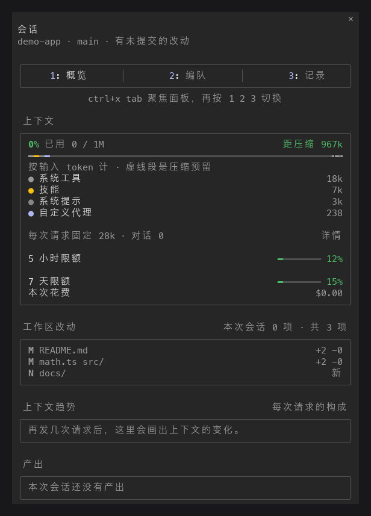
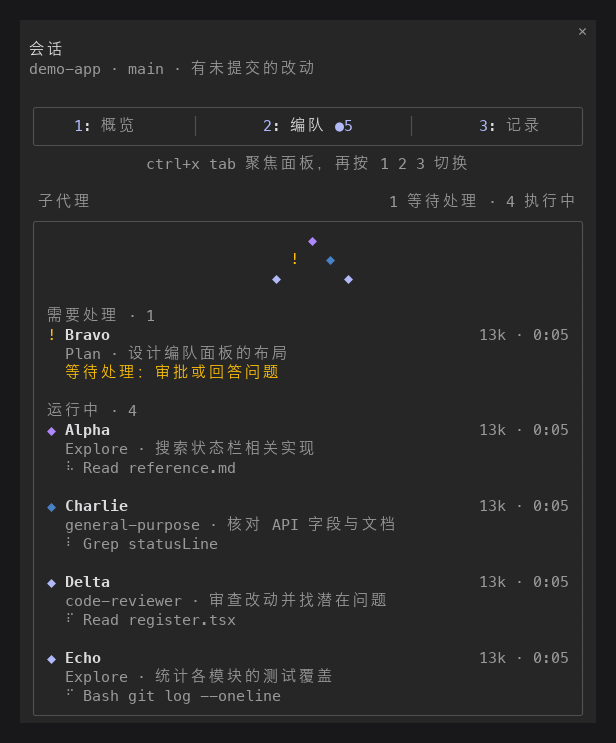

# Claude Session Panel

[中文说明](README.zh-CN.md)

A side pane for Claude Code in the terminal: what the desktop app's session overview shows, plus a per-request context trend, your subagents drawn as a formation, and a log of tool and skill calls.

| Overview | Formation |
|---|---|
|  |  |

## Install

In a Claude Code terminal session:

```
/plugin install session-panel --marketplace ZeroZ-lab/claude-session-panel
```

Answer `y` to add the marketplace, then pick a scope.

## Use

- The pane opens beside the chat on its own in the terminal's fullscreen layout (from 144 columns; 110 once you have opened it yourself). Elsewhere, open it with `/panel`.
- Three pages: **概览 Overview**, **编队 Formation**, **记录 Log**. Focus the pane with `ctrl+x tab`, then press `1` `2` `3`.
- `/panel [概览|编队|记录]` opens a page, `/panel demo` flies a five-ship demo, `/panel clear` clears finished ships and calls.
- Close the pane by hand and it stays closed in later sessions until you run `/panel` again.

## What it shows

- **Context**: usage, tokens left before auto-compaction, the compaction reserve, what fills the window (fixed per request vs. conversation, MCP servers, memory files), plan limits, cost.
- **Context trend**: one stacked bar per request or per turn, total or change; marks for compactions (with tokens before → after), drops and jumps, each jump named after the call whose result brought it in and its source (built-in, `mcp:<server>`, skill).
- **Working-tree changes**: this session's changes apart from those made before it began.
- **Outputs, connectors, environment**.
- **Formation**: each running subagent with its task, latest call, tokens and time; ones waiting on you come first.
- **Log**: tool and skill calls, runs folded (`Read ×5`), filters for failed / skill / MCP, and why each failure failed.

The text of the pane is in Chinese.

## License

MIT
