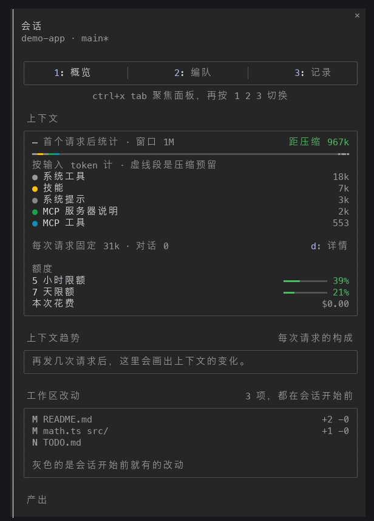
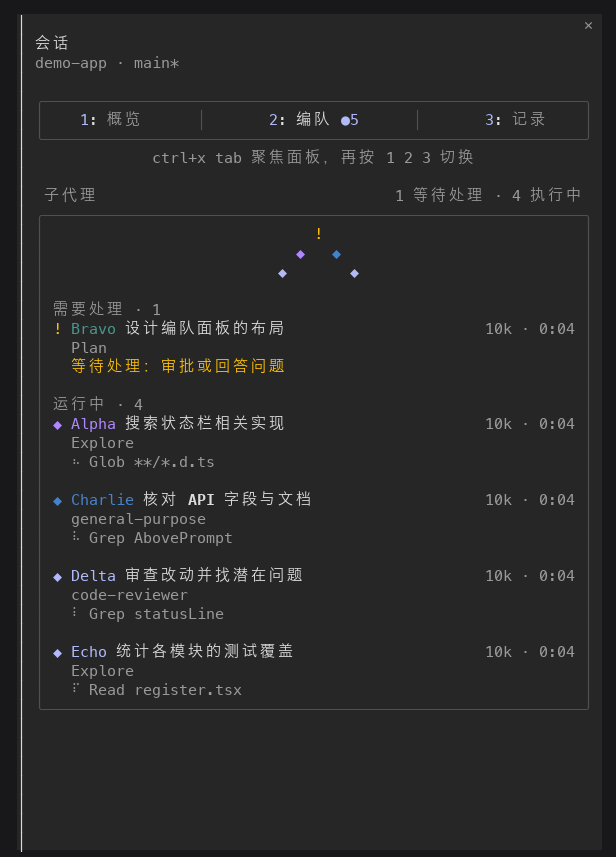

# Claude 会话面板

[English](README.md)

Claude Code 终端里的侧边面板：包含桌面版会话概览的内容，另外加上按请求的上下文趋势、把子代理画成编队的视图，以及工具和技能的调用记录。

| 概览 | 编队 |
|---|---|
|  |  |

## 运行要求

- 支持 mod（hooks 模块）的 Claude Code，已在 2.1.325 上测试。
- `PATH` 里有 `git`，工作区改动卡片需要它；没有 git，面板的其他部分照常工作。
- 终端全屏布局下面板停靠在对话旁边；其他布局下它显示在输入框上方，平时是一行摘要，手动打开后是精简版页面。

## 安装

在 Claude Code 终端会话里输入：

```
/plugin install session-panel --marketplace ZeroZ-lab/claude-session-panel
```

提示添加插件源时输入 `y`，再选择安装范围。

如果这一行报错（较早的 Claude Code 版本没有 `--marketplace` 参数），就先添加插件源再安装：

```
/plugin marketplace add ZeroZ-lab/claude-session-panel
/plugin install session-panel@claude-session-panel
```

也可以在终端里运行：`claude plugin marketplace add ZeroZ-lab/claude-session-panel && claude plugin install session-panel@claude-session-panel`。装好后重启 Claude Code。

**更新**：`claude plugin marketplace update claude-session-panel`，再 `claude plugin update session-panel@claude-session-panel`。
**卸载**：`claude plugin uninstall session-panel@claude-session-panel`。

## 使用

- 终端全屏布局下，面板会自动停靠在对话旁边（需要 144 列以上；你手动打开过一次后降到 110 列）。其他情况用 `/panel` 打开。
- 三页：**概览**、**编队**、**记录**。按 `ctrl+x tab` 聚焦面板后，按 `1` `2` `3` 切换。
- 面板聚焦时，按钮前面的字母就是它的快捷键：`d` 上下文详情，`t` 趋势切换总量/变化，`g` 趋势切换按请求/按轮，`a` `x` `s` `m` 是记录页的过滤（全部、失败、技能、MCP）。
- `/panel [概览|编队|记录]`（也可以写 `overview|fleet|log`）打开到指定页，`/panel demo` 放出五架演示子代理，`/panel clear` 清除已结束的子代理和调用。
- 手动关闭面板后，之后的会话也不会再自动弹出，输入 `/panel` 可以恢复。

## 显示内容

- **上下文**：用量、距自动压缩还剩多少、压缩预留、占用构成（每次请求的固定开销和对话开销、各 MCP 服务器、记忆文件）、套餐限额、花费。
- **上下文趋势**：每次请求或每轮一根堆叠柱，可切换总量和变化；标出压缩（含压缩前后的 token）、回落和突增，突增会写明是哪次调用带来的，以及来源（内置、`mcp:服务器`、技能）。
- **工作区改动**：区分本次会话的改动和会话开始前就有的改动。
- **产出、连接器、环境**。
- **编队**：每个运行中的子代理的任务、最新调用、token 和用时，等待你处理的排在最前。
- **记录**：工具和技能调用，连续的同类调用会合并（`Read ×5`），可按失败、技能、MCP 过滤，失败的调用写明原因。

## 隐私

所有数据都留在本机，这个 mod 自己不发任何网络请求。

- 面板可见时，它会在会话目录里运行 `git status`、`git diff --numstat` 和 `git rev-parse`（只读，带 `--no-optional-locks`）：每 15 秒一次，编辑文件后会提前一次。面板隐藏时不运行 git。
- 它读取改动文件的修改时间，用来区分本次会话的改动和之前的改动，不读文件内容。
- 它观察会话里的工具调用来生成记录，并从调用结果里提取 PR 链接（来自 `gh pr create`）和 artifact 链接，用于产出卡片。
- 跨会话只保存一个值：你是否手动关闭过面板。

## 常见问题

- **面板没出现**：把终端拉宽（自动打开需要 144 列），或者输入 `/panel`。如果之前手动关过，`/panel` 可以恢复。
- **显示不对**：用 `claude --debug` 启动，调试日志里每个出错的 hook 都有一行记录。
- **`-p` 和 SDK 运行时** mod 什么都不做，因为没有面板可画。

## 开发

```
claude plugin validate .
claude plugin test .
```

想试改动，用 `claude --plugin-dir <本目录>` 启动会话。

## 许可证

MIT
